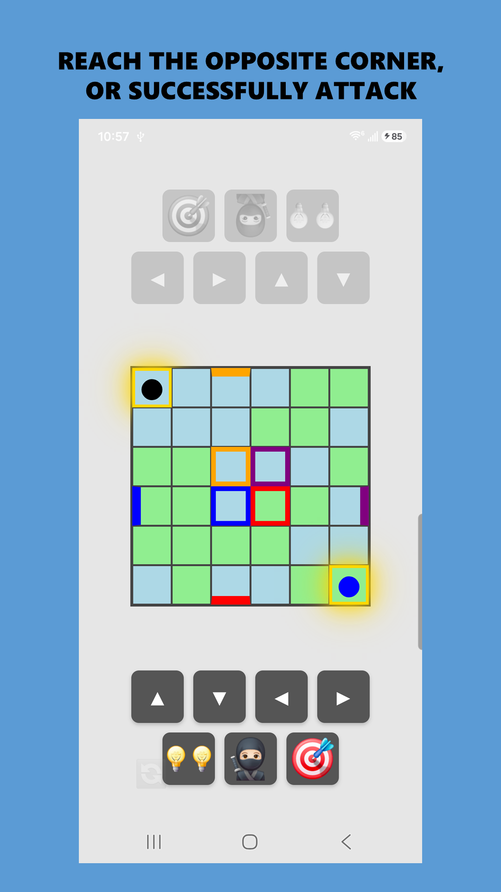

## 📖 TactiGrid Rules & Instructions

### Goal
* **Reach the Opposite Corner:** The first player to reach the opposite corner (the opponent's starting tile) wins.
* **Successful Attack:** The alternative way to win is by executing a successful attack.

### Movement and Action Buttons
* **◀ ▲ ▶ ▼ ("Move"):** Use the directional buttons to navigate the grid. To remain still on your turn, press 🥷🏻 **"Camouflage"**.
* **🥷🏻 ("Camouflage"):** Keeps your position static and automatically matches your character's color to the tile you are standing on for stealth.
* **💡 ("Glow an opponent"):** Reveals a camouflaged opponent, making them visible again. Each player is allowed **two** glows per game.
* **🎯 ("Attack"):** Has a range of two Manhattan steps. 
  * If the attack succeeds, **you win!** 
  * If the attack fails, **your opponent wins!**
* **The Doors:** The colored 'doors' located at the outer edges of the grid will funnel you back to the center.

### 🤫 Local Play Strategy Tip
* **Cover the Screen:** Since this is a 2-player local pass-and-play game on a single device, make sure to **cover the screen with your hand** when making your secret movement or action choice so your opponent can't peek!

---

## 📱 Play as a Web App (PWA)

"TactiGrid" can feel exactly like a native App Store download using a built-in mobile feature called **"Add to Home Screen."** It places a dedicated game icon right on your phone's home screen for instant access!

* **📱 On iPhone (Safari):** Tap the Share button at the bottom, scroll down, and tap **Add to Home Screen**.
* **🤖 On Android (Chrome):** Tap the three dots in the top right, and tap **Add to Home Screen** (or **Install app**).

When players launch TactiGrid from their home screen icon, the browser completely hides its top address bar and bottom navigation controls. It opens in glorious full-screen canvas mode, completely indistinguishable from a native app marketplace title.

---

## 🚀 Get More Free Apps
Alternatively, you are welcome to download this app, or any of my other apps, from the Google Play Store. All of my apps are **free, and none of them contain ads**.

[Browse all apps by markmcla on the Google Play Store](https://play.google.com/store/search?q=markmcla&c=apps)
